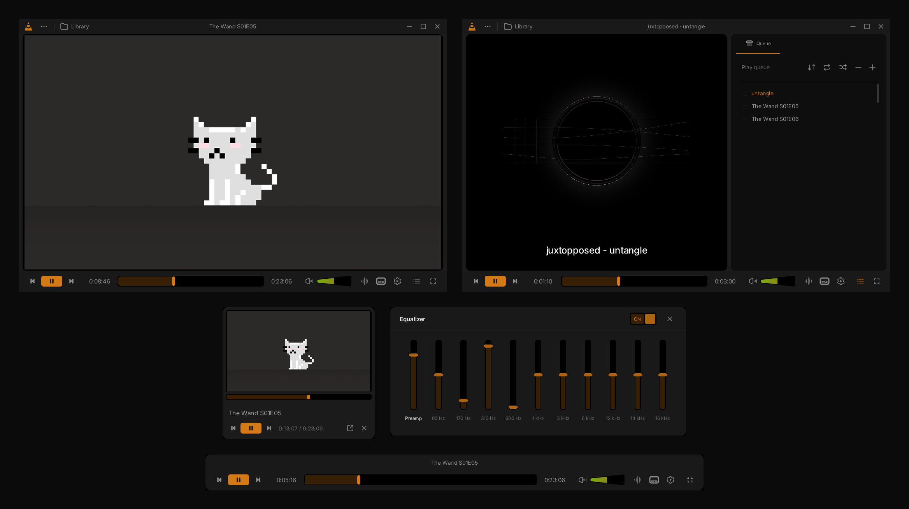
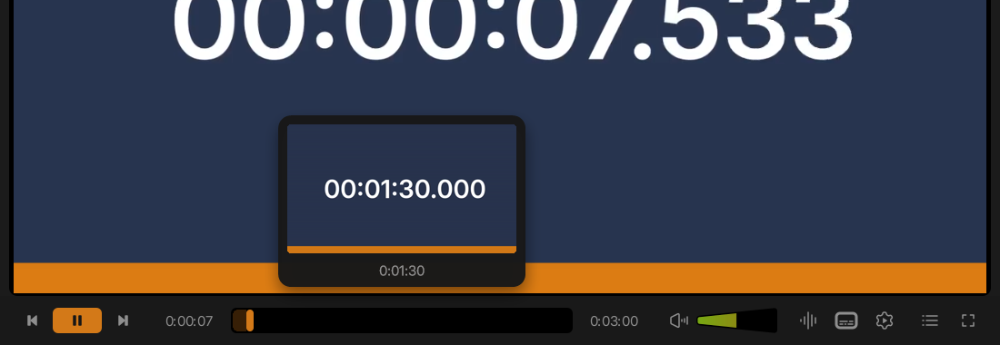

# VLC Redesign: a dark skin for VLC 3

A VLC skin based on Juxtopposed's **VLC Redesign** concept. It's dark and minimal, with VLC's orange as the accent.

**[Download the latest release](https://github.com/shinnahu/VLC-Redesign/releases/latest)**

## Features

- **Control row:** a thin row with a large orange play button, a thick seek bar that fills as it plays, and the "full cone" volume slider (green to red, up to 200 %).
- **Top bar:** a centred media title, VLC's menu under the cone, and a `...` menu for opening files, folders, streams and discs.
- **Queue panel:** opens inside the window. It has shuffle, repeat all/one, sort, add and remove, and you can drag items to reorder.
- **Other windows:** a mini player, a 10-band equalizer, and a floating fullscreen controller that shows the title.
- **Audio files:** show their cover art and the title in the middle.
- **Optional seek previews (Windows):** a small helper app shows a thumbnail when you hover the seek bar.

## Install

Download `VLC-Redesign.vlt` (or `VLC-Redesign-skin.zip`, which adds an install guide) from the [latest release](https://github.com/shinnahu/VLC-Redesign/releases/latest).

**Windows**
1. Copy `VLC-Redesign.vlt` into `%APPDATA%\vlc\skins`. Paste that path into File Explorer's address bar, and create the `skins` folder if it doesn't exist.
2. In VLC, open **Tools > Preferences > Interface** and choose **Use custom skin**.
3. Select the `.vlt` file, click **Save**, then close and reopen VLC.

**Linux:** copy the `.vlt` into `~/.local/share/vlc/skins2/`, then follow the same steps.

**Faster start (optional):** VLC unpacks a `.vlt` every time it starts. To skip that, run `tar -xf VLC-Redesign.vlt` in the skins folder, then select `VLC-Redesign/theme.xml` in Preferences instead. Videos open about 0.3 s faster.

**Back to the normal look:** click the cone (or right-click the video) > **Tools > Preferences > Interface**, choose **Use native style**, save and restart.

VLC 3.x on Windows and Linux. VLC for macOS does not support skins. Tested with VLC 3.0.21 on Windows 11.

## Seek-bar previews (optional, Windows)

`VLC-Seek-Preview-helper.zip` contains a small tray app. While it runs, hovering the seek bar of this skin shows a frame from that moment with its time.

It needs the [.NET 8 Desktop Runtime](https://dotnet.microsoft.com/download/dotnet/8.0) and [ffmpeg](https://ffmpeg.org/download.html), with `ffmpeg` and `ffprobe` on PATH. The exe isn't signed, so Windows may warn about an unknown publisher the first time you run it.

## Limits of VLC skins

- **Resizing:** works only from the right edge, the bottom edge and the bottom-right corner. VLC's skin engine can't resize from the left or top.
- **The video window:** a skin can't draw over it, so there's no blur and no see-through bars on top of the video.
- **Native VLC windows:** the library, subtitle and audio menus are VLC's own.

## Credits and licences

- **Design:** "VLC Redesign" by Juxtopposed (Figma Community file), licensed under [CC BY 4.0](https://creativecommons.org/licenses/by/4.0/). This skin adapts that design for VLC's skin engine, and changes were made.
- **Font:** [Inter](https://rsms.me/inter/) by Rasmus Andersson, SIL Open Font License 1.1. It's included in the skin.
- **Trademarks:** VLC and the cone are trademarks of VideoLAN. This is an unofficial skin.

See [LICENSE.md](LICENSE.md).
